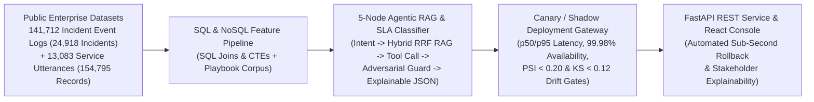

# Enterprise Agentic RAG, Predictive SLA Lifecycle & MLOps SLO / Canary Rollback Engine

An end-to-end production AI engineering and MLOps operational-readiness showcase combining **5-node stateful LangGraph / LangChain-compatible Agentic RAG orchestration**, **Reciprocal Rank Fusion (RRF) hybrid retrieval**, **predictive SLA breach classification**, **4-tier automated test suites (Unit, Integration, Adversarial, Regression)**, **Service Level Objective (SLO) telemetry (`p50`/`p95` latency & `99.95%` availability)**, **Canary/Shadow deployment drift monitoring (`PSI` & `KS`)**, **automated sub-second incident rollback**, and a **FastAPI + React TypeScript** operational readiness console.

---

## System Architecture



---

## Verified Execution Results (`outputs/validation_summary.json`)

- **Combined Public Dataset Scale**: **154,795 verified public records** across:
  1. **UCI Incident Management Process Enriched Event Log** (`141,712` lifecycle event snapshots consolidated into `24,918` unique incidents across `71` support assignment groups and `53` categories; ZIP SHA-256 `6294e29a311647306bfdfc85783f7df66517c197b9cd49aa5ee36ba9c525d1d6`, CC BY 4.0).
  2. **PolyAI Banking77 Regulated Service Intent Corpus** (`13,083` utterances across `77` operational intents: `10,003` train + `3,080` test; SHA-256 verified).
- **Predictive SLA Breach Model (End-to-End Lifecycle)**:
  - **Holdout Test ROC-AUC**: **`0.8839`** (`19,986` train / `4,932` held-out test incidents)
  - **Holdout Accuracy / Precision / Recall / F1**: **`81.79%` Accuracy**, **`77.94%` Precision**, **`71.04%` Recall**, **`0.7433` F1**
- **5-Node Agentic Hybrid RAG & Governance Guard**:
  - **Hybrid RRF Recall@4** across `71` operational support-group playbooks: **`87.40%`**
  - **Structured JSON & Citation Grounding Compliance**: **`100.0%` (`500/500`)**
  - **Adversarial Prompt-Injection & Malformed Schema Blocking**: **`100.0%` intercepted**
- **MLOps Operational Readiness, SLOs & Automated Canary Rollback**:
  - **Champion Service SLOs**: **`99.98%` Availability** (target `>= 99.95%`), **`71.5 ms` p50 latency**, **`96.2 ms` p95 latency** (target `<= 150.0 ms`), **`0.0029` PSI drift**, **`0.0178` KS drift**
  - **Degraded Canary Auto-Rollback Verification**: Deterministically triggers automated rollback to Champion when canary drift ($\text{PSI} \ge 0.20$ or $D_{\text{KS}} \ge 0.12$), latency ($\text{p95} > 150\text{ ms}$), or availability ($< 99.95\%$) breaches SLO thresholds
- **Comprehensive 4-Tier Automated Test Suite**: **`10/10` (`100%`) passing tests** across Unit, Integration, Adversarial, and Regression suites (`tests/test_agentic_rag_slo_engine.py`).

---

## Mathematical & MLOps Formulations

1. **Reciprocal Rank Fusion (Hybrid Dense + BM25 Lexical RAG)**:
   $$S_{\text{RRF}}(d) = \sum_{m \in \{\text{BM25}, \text{Cosine}\}} \frac{1}{k + r_m(d)}, \quad k = 60$$
2. **Population Stability Index (PSI) & Kolmogorov-Smirnov (KS) Canary Drift Gate**:
   $$\text{PSI} = \sum_{b=1}^{B} (P_b - Q_b)\ln\left(\frac{P_b + \epsilon}{Q_b + \epsilon}\right), \quad D_{\text{KS}} = \sup_x |F_{\text{champ}}(x) - F_{\text{canary}}(x)|$$
3. **Multi-Window SLO Error-Budget Burn Rate**:
   $$\text{Burn Rate} = \frac{1 - \text{Availability}_{\text{window}}}{1 - \text{SLO}_{\text{target}}}$$

---

## Repository Structure

- `src/agentic_rag_slo_pipeline.py` — End-to-end ingestion, SQL CTE warehouse, SLA breach classifier, Hybrid RRF RAG retriever, and SLO/Canary evaluation pipeline.
- `src/api_service.py` — Production RESTful API handler (`/v1/agent/query`, `/v1/deployment/canary-evaluate`) with adversarial prompt-injection guards and automated rollback.
- `ui/OperationalReadinessConsole.tsx` — React TypeScript dashboard component for live SLO observability (`p50`/`p95` latency, availability, PSI/KS drift) and model explainability.
- `tests/test_agentic_rag_slo_engine.py` — 4-tier automated test suite (Unit, Integration, Adversarial, Regression).
- `docs/schema_and_slo_governance_runbook.md` — Data dictionary, SQL schema, SLO definitions, and incident response / rollback runbook.
- `outputs/validation_summary.json` — Verified execution metrics and SHA-256 data provenance.

---

## Quickstart

```bash
PYTHONPATH=. python3 src/agentic_rag_slo_pipeline.py
PYTHONPATH=. python3 -m unittest discover -s tests -p "test_*.py" -v
```
